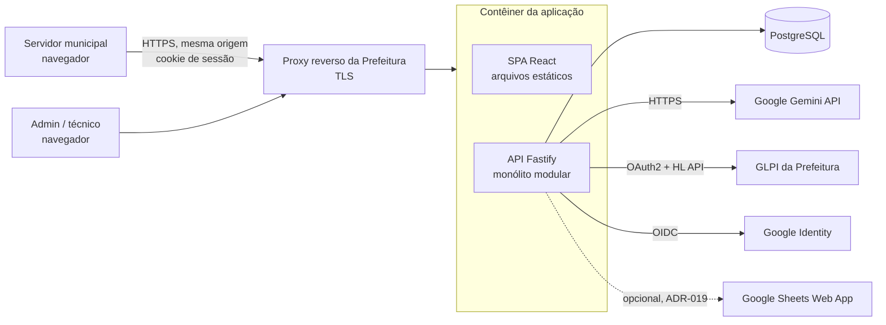
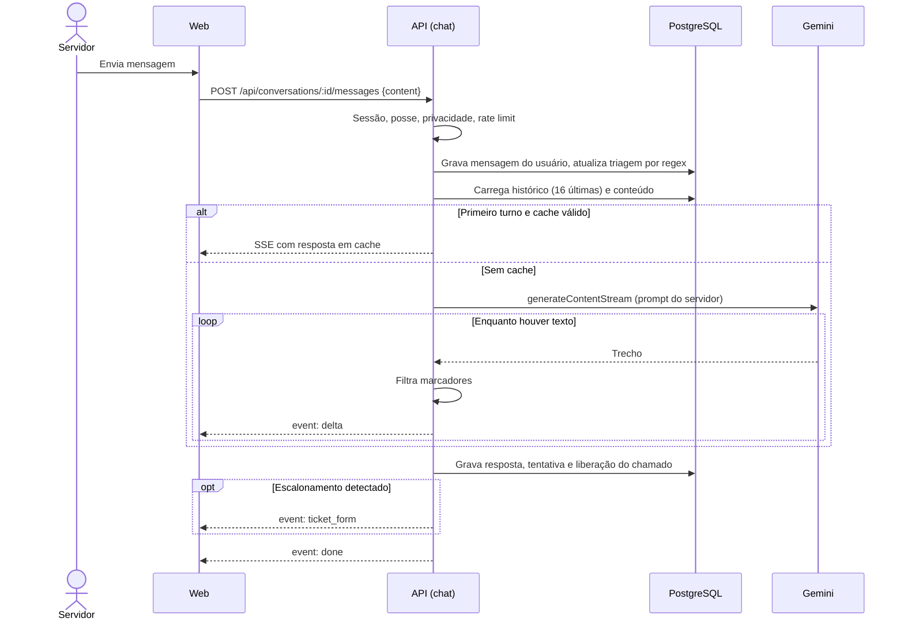
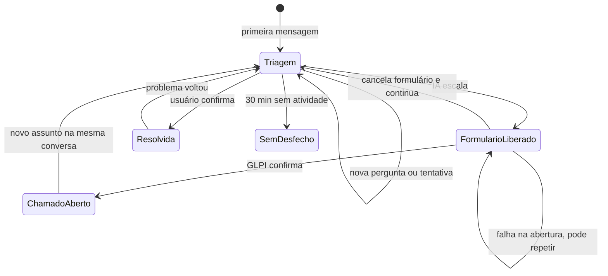
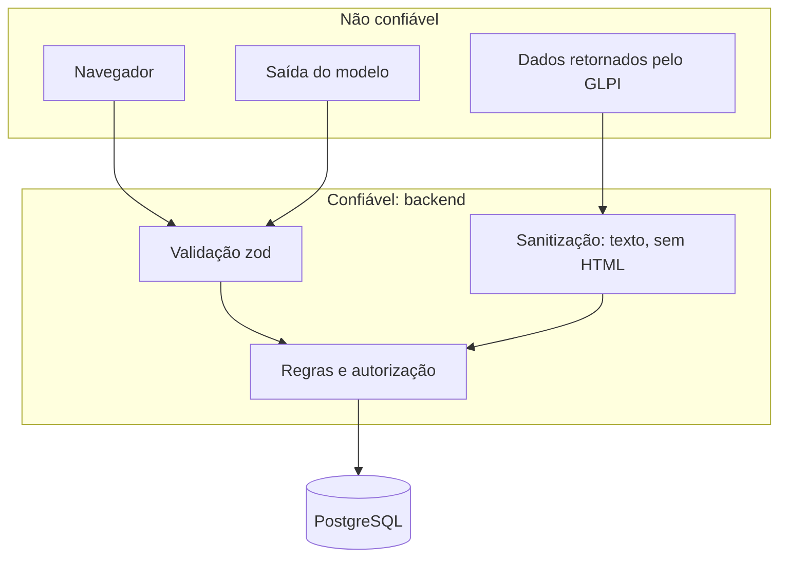
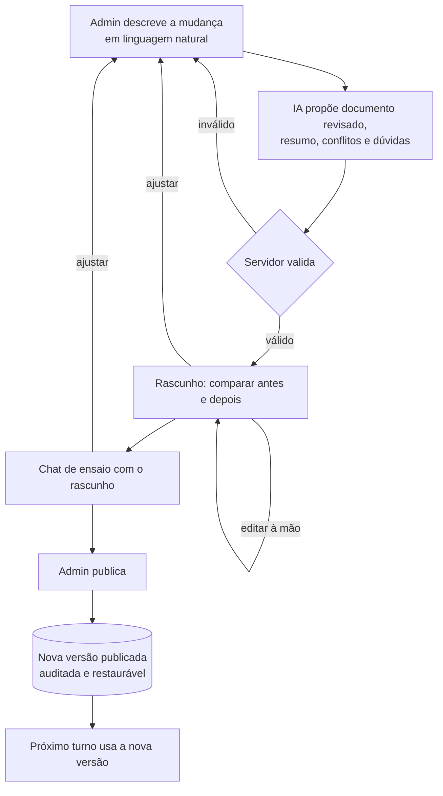

# Arquitetura — ChicoChat+

**Situação: PROPOSTA, aguardando aprovação.** As justificativas completas estão em [DECISIONS.md](DECISIONS.md); os fatos sobre o sistema antigo, em [LEGACY_AUDIT.md](LEGACY_AUDIT.md).

## 1. Visão geral

Um único processo Node (API + arquivos do frontend) e um PostgreSQL. O navegador só fala com a API. Gemini e GLPI são chamados só pelo backend.



**Princípios**

1. **O backend controla o que é crítico.** Identidade, papel, posse da conversa, liberação de chamado e categoria válida nunca vêm da IA nem do cliente sem validação.
2. **A IA conversa e resume; não decide autoridade.** Sua saída é tratada como dado não confiável: marcadores são filtrados, JSON é validado e markdown é renderizado sem HTML.
3. **Fluxo de dependência para dentro.** Rotas chamam serviços; serviços usam repositórios e integrações; integrações não conhecem regras de negócio.
4. **Falhas são estados previstos.** IA ou GLPI indisponíveis geram mensagem útil e caminho alternativo, nunca tela quebrada.
5. **Simplicidade antes de escala.** Sem Redis, filas, microserviços ou Kubernetes até haver necessidade medida.

## 2. Estrutura de diretórios

Tudo abaixo de `novochico/` (ADR-026).

```text
novochico/
├─ CLAUDE.md                 Instruções permanentes para o Claude Code
├─ package.json              Workspaces e scripts de raiz
├─ .nvmrc  .gitignore  .env.example
├─ compose.yml               PostgreSQL de desenvolvimento
├─ docs/                     Documentação do projeto e PDF da marca
├─ packages/
│  └─ shared/src/            Contratos entre web e API (somente zod e tipos)
│     ├─ api/                Requisição e resposta de cada endpoint, eventos SSE
│     └─ domain/             Constantes de domínio: categorias, urgências, papéis
├─ apps/
│  ├─ api/
│  │  ├─ src/
│  │  │  ├─ server.ts        Inicializa o processo
│  │  │  ├─ app.ts           Monta o Fastify: plugins e módulos (testável sem porta)
│  │  │  ├─ config/          Leitura e validação do ambiente (único acesso a process.env)
│  │  │  ├─ http/            Plugins transversais: erro, auth, csrf, rate limit, helmet, static
│  │  │  ├─ db/              Cliente, schema Drizzle, seed
│  │  │  ├─ modules/         Domínio; um diretório por área
│  │  │  │  ├─ auth/  users/  conversations/
│  │  │  │  ├─ chat/         Orquestração do turno; prompt/ e stream-filter
│  │  │  │  ├─ tickets/      Abertura, resumo, duplicidade, listagem
│  │  │  │  ├─ transcripts/  content/  feedback/  analytics/  audit/
│  │  │  │  └─ reporting/    Opcional (F10)
│  │  │  ├─ integrations/    Clientes externos, sem regra de negócio
│  │  │  │  ├─ gemini/  glpi/
│  │  │  └─ lib/             Utilitários sem domínio: logger, erros, texto
│  │  ├─ drizzle/            Migrations SQL geradas
│  │  ├─ scripts/            CLI: admin:grant
│  │  └─ test/               Fakes de GLPI e Gemini, utilitários de teste
│  └─ web/src/
│     ├─ app/                Rotas, providers, layouts, guardas
│     ├─ features/           chat/  tickets/  auth/  admin/
│     ├─ components/         Componentes genéricos da marca (Button, Dialog, Field…)
│     ├─ lib/                Cliente HTTP, cliente SSE, formatadores
│     ├─ styles/             Tokens e estilos globais
│     └─ assets/             Logos e fontes auto-hospedadas
└─ e2e/                      Playwright
```

Estrutura de um módulo de backend:

```text
modules/tickets/
├─ routes.ts            HTTP: valida entrada, chama serviço, devolve resposta
├─ service.ts           Regras de negócio e orquestração
├─ repository.ts        SQL. Só o módulo acessa suas tabelas
├─ *.ts                 Regras puras (ex.: duplicate-detection.ts)
└─ *.test.ts            Testes ao lado do código
```

## 3. Limites entre camadas

| Limite | Responsabilidade | Não pode |
|---|---|---|
| **Interface** (`apps/web`) | Renderizar, capturar entrada, validar para UX | Decidir regras; falar com banco, GLPI ou Gemini; interpretar marcadores |
| **Rotas** (`routes.ts`) | Autenticar, validar, mapear para HTTP | Conter regra de negócio ou SQL |
| **Regras** (`service.ts`, regras puras) | Decidir | Conhecer HTTP; montar requisição externa |
| **Integrações** (`integrations/`) | Falar o protocolo externo, com timeouts e erros tipados | Conhecer categorias, usuários ou triagem |
| **Persistência** (`repository.ts`, `db/`) | SQL e mapeamento | Decidir autorização; receber dado sem usuário autenticado quando houver posse |
| **Configuração** (`config/`) | Validar ambiente na partida e falhar cedo | Ter valores secretos padrão |
| **Autenticação** (`modules/auth`, `http/auth`) | Sessão, provedores, domínios, `requireRole` | Confiar em dados do cliente ou da IA |

Regra de importação (verificada por lint na F0): `web` e `api` importam `shared`; `shared` não importa ninguém; `integrations` não importa `modules`; módulos só se comunicam via `service.ts`.

## 4. Módulos do backend

| Módulo | Responsabilidade | Usa |
|---|---|---|
| `auth` | Login Google, sessão, logout, domínio permitido | `openid-client`, `users` |
| `users` | Perfil, papel, aceite de privacidade | — |
| `conversations` | CRUD, posse, títulos, sessão de atendimento | — |
| `chat` | Turno: gravar, montar prompt, chamar IA, filtrar stream, atualizar triagem | `conversations`, `content`, `analytics`, `gemini` |
| `tickets` | Duplicidade, resumo, abertura, "meus chamados" | `conversations`, `transcripts`, `analytics`, `gemini`, `glpi` |
| `transcripts` | Snapshot, token, leitura autorizada | `audit` |
| `content` | Cards e instruções do agente: versões, assistente, ensaio, publicação, versão do prompt | `gemini`, `audit` |
| `feedback` | Avaliações | `analytics` |
| `analytics` | Registrar eventos, consultas agregadas, CSV, Análise IA | `gemini`, `audit` |
| `audit` | Registrar ações sensíveis | — |
| `reporting` | Outbox para Sheets (opcional) | — |

## 5. Fluxos principais

### 5.1 Turno de conversa



### 5.2 Abertura de chamado

```mermaid
sequenceDiagram
  actor U as Servidor
  participant W as Web
  participant A as API (tickets)
  participant D as PostgreSQL
  participant M as Gemini
  participant L as GLPI

  U->>W: Preenche setor, IP, terceiro
  W->>A: POST /api/conversations/:id/ticket-check
  A->>D: Chamados do usuário (7d) e globais (2h)
  A-->>W: Duplicados e incidente coletivo
  opt Há aviso
    U->>W: "Abrir mesmo assim"
  end
  W->>A: POST /api/conversations/:id/tickets (Idempotency-Key)
  A->>A: Sessão, posse, liberação, validação
  A->>D: Cria tentativa pending (única por chave)
  A->>M: Resumo estruturado (3 tentativas)
  Note over A,M: Falhou? Resumo de contingência; não bloqueia
  A->>L: Token OAuth (cache)
  A->>L: Busca solicitante por e-mail da sessão
  A->>L: POST Ticket
  alt Sucesso
    L-->>A: id
    A->>L: Anexa solicitante (melhor esforço)
    A->>D: Conclui tentativa, snapshot, mensagem, evento
    A-->>W: 201 {glpiTicketId}
  else Falha ou timeout
    A->>D: failed ou unknown, evento
    A-->>W: Erro seguro e link do portal
  end
```

### 5.3 Estados da conversa



"Resolvida", "chamado aberto" e "sem desfecho" alimentam indicadores (ADR-018). Nenhum estado impede o usuário de continuar a conversa.

### 5.4 Fronteiras de confiança



### 5.5 Alteração das instruções do agente



O prompt enviado ao Gemini tem duas origens: regras fixas, do código, e instruções publicadas, do banco. As fixas têm prioridade expressa, e a IA do assistente só edita as instruções (ADR-030).

## 6. Integrações

| Integração | Cliente | Contrato interno | Falha |
|---|---|---|---|
| Gemini | `integrations/gemini` | `LlmClient.streamChat()`, `LlmClient.generateJson(schema)` | Retry em 429/5xx, breaker; sem IA, oferece portal GLPI |
| GLPI | `integrations/glpi` | `getAccessToken`, `findUserIdByEmail`, `createTicket`, `addRequester`, `listTicketsForUser`, `getTicket` | Erro tipado `GlpiError{kind}`; nunca reenvia criação |
| Google OIDC | `modules/auth` com `openid-client` | — | Mensagem clara; sem método alternativo (ADR-027) |
| Sheets | `modules/reporting` | Outbox | Isolada do atendimento |

## 7. Segurança em camadas

| Camada | Controle |
|---|---|
| Transporte | TLS no proxy; HSTS; cookie `Secure` |
| Sessão | `HttpOnly`, `SameSite=Lax`, expiração, revogação no banco |
| CSRF | `SameSite` + checagem de `Origin` em métodos de escrita |
| Autorização | `requireAuth`, `requireRole` e checagem de posse nos serviços |
| Entrada | zod em toda rota; limites de tamanho |
| Saída | Markdown sem HTML; CSP restritiva; respostas com campos explícitos |
| Abuso | Rate limit por usuário e IP; semáforo para a IA; limites de tamanho |
| Segredos | Só no ambiente do servidor; nada com prefixo `VITE_` é segredo |
| Logs | Redação de PII; IDs internos no lugar de dados pessoais |
| Dados | Usuário de banco sem superusuário; backups (`PEND-08`); retenção (`PEND-07`) |
| Auditoria | Leitura de conversas e transcrições, exportações, papéis, conteúdo |

## 8. Alternativas consideradas

| Tema | Escolha | Principais alternativas descartadas | ADR |
|---|---|---|---|
| Backend | Fastify modular | Next.js, NestJS, Hono, microserviços | 003 |
| Banco | PostgreSQL | Supabase self-hosted, SQLite, MySQL | 004 |
| ORM | Drizzle | Prisma, Kysely, SQL puro | 005 |
| Frontend | React + Vite | Next.js | 006 |
| UI | Tailwind + Radix seletivo | shadcn completo, MUI | 007 |
| Auth | Google OIDC + cookie | Senha, Better Auth, Supabase Auth, Keycloak | 027 |
| Sinalização da IA | Marcadores no servidor | Function calling (reavaliar depois) | 011 |
| Cache e fila | Em processo + PostgreSQL | Redis/BullMQ | 019, 020 |

## 9. Evolução prevista, sem implementação agora

Mantidos fora do escopo. Registrados para não exigir mudança de arquitetura:

- SSO corporativo: novo provedor em `modules/auth`.
- Mais de uma instância da API: mover rate limit, semáforo e breaker para armazenamento compartilhado.
- Conhecimento na IA (`PEND-14`): novo passo em `chat/prompt`.
- Outros canais, como WhatsApp: novo adaptador sobre `chat.service`, que já não depende de HTTP.
