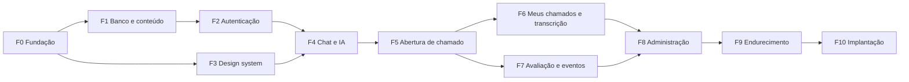

# Plano de implementação — ChicoChat+

**Situação: PROPOSTA.** Nenhuma fase começa sem aprovação da arquitetura e da documentação.

## Como executar

1. Faça **uma fase por vez**, na ordem. Cada fase é uma branch `feat/fNN-nome`.
2. Antes de começar, leia a fase, as seções indicadas de [SONNET_CONTEXT.md](SONNET_CONTEXT.md) e as ADRs citadas.
3. Pendência marcada como **bloqueante**: pare e pergunte. Pendência **com padrão**: use o padrão e deixe-o configurável.
4. Só encerre com todos os critérios cumpridos e os testes passando. Se um item não puder ser verificado, registre isso.
5. Ao final, faça uma revisão com o Opus. Commit e push só quando o responsável pedir.

Comandos que toda fase precisa deixar passando: `npm run lint`, `npm run typecheck`, `npm test`.

## Pendências por fase

| Fase | Bloqueante | Com padrão |
|---|---|---|
| F0 | — | `PEND-02`: repositório público, sem segredos nem dados reais (ADR-031) |
| F1 | — | `PEND-04` (seed mínimo), `PEND-06`, `PEND-14`, `PEND-16` |
| F2 | — | `PEND-15` |
| F3 | — | `PEND-09` |
| F4 | `PEND-17` para chamar o Gemini real; fakes não dependem disso | `PEND-18` |
| F5 | `PEND-05` para saber a versão do GLPI; fakes não dependem disso | `PEND-13`, `PEND-18` |
| F6 | — | `PEND-10` |
| F8 | — | `PEND-07` |
| F10 | `PEND-07`, `PEND-08`; `PEND-12` só para reporting | — |

---

## F0 — Fundação

**Objetivo:** projeto vazio, rodando e verificável, sem funcionalidade de negócio.

**Módulos:** raiz de `novochico/`, `apps/api` (`app.ts`, `server.ts`, `config/`, `http/`, `lib/logger`), `apps/web` (página mínima), `packages/shared`, `compose.yml`, `.env.example`, `.gitignore`, ESLint, Prettier, Vitest.

**Dependências:** nenhuma.

**Critérios de conclusão**
- `npm install && docker compose up -d && npm run dev` sobe web e API; a web exibe a resposta de `GET /api/health`, que verifica o banco.
- Configuração inválida ou ausente faz a API falhar na partida com mensagem clara, sem revelar valores.
- Logger com redação de `authorization`, `cookie`, `password`, `email`, `content` e tratador de erro padrão.
- Regra de lint para os limites de importação (`ARCHITECTURE.md`, seção 3).
- `.gitignore` existente mantido e ampliado; `.env` e `docs/LEGACY_AUDIT.md` continuam ignorados; `.env.example` só com valores fictícios.

**Testes:** `health` com o banco ligado e desligado; validação de configuração; logger não imprime campos sensíveis.

**Riscos:** configuração excessiva. Mantenha só o necessário para os critérios.

---

## F1 — Banco e conteúdo

**Objetivo:** schema completo e conteúdo inicial carregável.

**Módulos:** `db/schema`, `drizzle/`, `db/seed`, `modules/content` (leitura), `packages/shared/domain`. Especificação em `SONNET_CONTEXT.md`, seção F.

**Dependências:** F0.

**Critérios de conclusão**
- Migrations geradas e aplicáveis a banco vazio; nenhuma contém dados reais.
- Seed idempotente com os cards do Anexo C e a versão 1 das instruções, conforme o Anexo E e a seção F.6, **sem nomes, e-mails, UUIDs ou dados de produção**.
- Índices e restrições da seção F aplicados, inclusive um único `published` e um único `draft`.
- Assunto sem fonte fica indicado para a SATD completar; nunca é inventado.
- Documento inicial revisado pelo Opus antes de encerrar a fase.

**Testes:** migration em banco limpo; seed executado duas vezes sem duplicar; restrições rejeitam nota 6, papel inválido e segunda versão publicada; `content.getPublishedInstructions()` retorna a versão publicada.

**Riscos:** o conteúdo em produção pode divergir do versionado (`PEND-04`). O seed é ponto de partida, não verdade institucional; a SATD revisa antes da estreia.

---

## F2 — Autenticação e autorização

**Objetivo:** só contas institucionais entram; papéis funcionam.

**Módulos:** `modules/auth`, `modules/users`, `http/auth`, `http/csrf`, CLI `admin:grant`, telas de login e aviso de privacidade (estrutura; acabamento visual após F3).

**Dependências:** F1. ADRs 009, 023, 027.

**Critérios de conclusão**
- Login Google real em ambiente de desenvolvimento, com `state`, `nonce` e PKCE; `hd` e `email_verified` validados no servidor.
- Domínio fora de `ALLOWED_EMAIL_DOMAINS` é rejeitado, mesmo com token Google válido.
- Sem nenhum cadastro, senha ou SMTP.
- Sessão em cookie `HttpOnly`, renovação e logout com revogação.
- `requireAuth` e `requireRole` aplicados por padrão: rota pública precisa de marcação explícita.
- Escrita sem `Origin` válido é rejeitada.
- Aceite de privacidade registrado no servidor (data e versão do aviso); chat recusa sem aceite.

**Testes:** matriz de autorização anônimo/user/tecnico/admin por rota; domínio inválido; sessão expirada e revogada; CSRF; rate limit de login. OIDC testado com token assinado por chave local.

**Riscos:** alguma conta institucional não conseguir autenticar. Confirme com contas reais, com o responsável presente.

**Situação:** implementada (ADR-034). Verificado com provedor OIDC local e `openid-client` real; **o login com o Google de verdade ainda não foi exercitado**, pois depende das credenciais OAuth do responsável.

---

## F3 — Design system e estrutura visual

**Objetivo:** base visual própria, antes de construir telas.

**Módulos:** `apps/web/src/styles`, `components/`, `app/layouts`, `assets/`. Especificação na seção I.

**Dependências:** F0. Pode correr em paralelo a F1 e F2. ADRs 007, 024, 025.

**Critérios de conclusão**
- Tokens de claro e escuro; tema segue o sistema e persiste a escolha, sem flash.
- Inter e Montserrat auto-hospedadas; nenhuma requisição a CDN externa.
- Componentes: Button, IconButton, Field, Input, Textarea, Checkbox, Dialog, Select, Tooltip, Toast, Skeleton, EmptyState, ErrorState, Markdown, Logo.
- Página `/_design` (só em desenvolvimento) mostra componentes e estados nos dois temas.
- Avaliação visual feita em 360, 768 e 1280px; alvos de toque ≥ 44px; foco visível.

**Testes:** axe na página de design; regras de contraste calculadas sobre os tokens; `Markdown` não renderiza HTML nem `javascript:`.

**Riscos:** aparência genérica. Revise com o Opus a página de design **antes** de seguir para F4.

**Situação:** implementada (ADR-035, `DESIGN_SYSTEM.md`). Ficaram de fora, por falta de arquivo (PEND-09): logotipo em vetor, grafismos e Velocity. Falta a revisão do Opus e a avaliação visual em aparelho real.

---

## F4 — Chat e integração com a IA

**Objetivo:** triagem real, ponta a ponta, com estado no servidor.

**Módulos:** `modules/conversations`, `modules/chat` (`prompt/`, `stream-filter`, `triage`, `resilience`, `response-cache`), `integrations/gemini`, `features/chat`.

**Dependências:** F2, F3. ADRs 010, 011, 020, 030. Requisitos RF-010 a RF-029.

**Critérios de conclusão**
- Tela inicial, cards, sugestão de categoria, histórico e streaming funcionam com fake e, se houver chave, com Gemini real.
- Cliente envia só o texto; papéis e histórico vêm do banco.
- Marcador nunca chega ao navegador, mesmo dividido entre trechos.
- Escalonamento grava `ticket_form_unlocked_at` e emite `ticket_form`; bypass só para `admin`.
- Queda da IA mostra o erro certo e link do portal; 503 e 429 têm mensagens próprias; a conversa não se perde.
- Recarregar a página mantém histórico e estado do formulário.
- Cache sem os defeitos B-01 e B-02.
- Sugestão de categoria sem B-03.

**Testes:**
- Filtro de stream (marcador dividido em todos os pontos).
- Montagem do prompt (porte de `agent-prompt.test.ts`, sobre o módulo).
- Títulos, sugestor, regex de resolução e persistência.
- Posse: usuário B não acessa conversa de A.
- Breaker e semáforo.
- E2E com fake do Gemini: conversa até liberar o formulário.
- **Suíte de cenários** (`npm run eval:chat`, sem CI, exige chave): para cada caso do Anexo D, verifica uma pergunta por turno, ausência de pedido de IP e de JSON, SEI → Joseias, pedido direto não escala.

**Riscos:** regressão de comportamento com o SDK. Se houver divergência, compare com o endpoint compatível antes de alterar o prompt.

**Situação:** implementada com fake (ADR-036). **Não verificado:** o Gemini real e a suíte `npm run eval:chat` (Anexo D), que dependem da chave no `.env`. O formulário de chamado é da F5.

---

## F5 — Abertura de chamado no GLPI

**Objetivo:** do formulário ao chamado, com identidade da sessão e sem duplicar.

**Módulos:** `integrations/glpi`, `modules/tickets` (`service`, `summary`, `fallback-summary`, `duplicate-detection`, `description`), `features/tickets`.

**Dependências:** F4. ADRs 012, 013, 017. Requisitos RF-030 a RF-049.

**Critérios de conclusão**
- `POST` sem liberação retorna 403 (salvo admin); identidade vem da sessão, sem campos de nome/e-mail aceitos na API.
- Formato, parâmetros e contingência de resumo idênticos à seção G.
- Mesma chave de idempotência nunca cria dois chamados, nem em requisições simultâneas.
- Timeout na criação gera estado `unknown`, sem reenvio automático, com mensagem orientando verificar antes de repetir.
- Erro ao usuário é seguro; detalhe técnico só em log.
- Duplicidade reproduz os limiares de RN-28 a RN-31, usando só chamados do usuário autenticado.
- Modo de teste só para `admin`, com `is_test=true`, fora de métricas e duplicidade.
- Textos sem promessas não implementadas (B-13).

**Testes:**
- Contrato do cliente GLPI contra fake HTTP (sucesso, 401, 403, 404, 500, timeout, sem `id`, requester não encontrado).
- Resumo: JSON inválido, seções fora de ordem, contingência sem transcrição.
- Duplicidade: tabela de casos com limiares exatos.
- Idempotência concorrente.
- E2E completo com fakes.

**Homologação (ADR-029):** primeiro, contra um GLPI em Docker local na mesma versão da instância (`PEND-05`). Depois, o menor número possível de chamados marcados como teste em produção, com o responsável presente. Não há instância de teste. **Nunca execute contra produção sem autorização explícita naquele momento.**

**Riscos:** contrato de `TeamMember` e campos da instância; versão da API.

---

## F6 — Meus chamados e transcrição

**Objetivo:** consultar chamados e dar contexto ao técnico, sem expor dados.

**Módulos:** `modules/tickets` (listagem), `modules/transcripts`, `features/tickets`, rota `/conversa/:token`.

**Dependências:** F5. ADR-016. Requisitos RF-050 a RF-059.

**Critérios de conclusão**
- Chamados listados só para o e-mail da sessão; resposta em JSON renderizado em componente próprio, sem HTML nem markdown bruto vindo do GLPI.
- Descrição do GLPI convertida para texto plano por biblioteca testada.
- Transcrição: sem login vai para o login e volta; sem papel recebe 403; acesso auditado; token só em hash.
- Usuário sem cadastro no GLPI e GLPI fora do ar têm mensagens próprias.

**Testes:** autorização da transcrição; XSS com `&lt;img onerror&gt;` na descrição; usuário A não lista chamados de B.

**Riscos:** técnicos sem conta (`PEND-10`).

---

## F7 — Avaliação e eventos

**Objetivo:** feedback e métrica confiável.

**Módulos:** `modules/feedback`, `modules/analytics` (registro), `features/chat`.

**Dependências:** F5. ADR-018. Requisitos RF-060 a RF-065.

**Critérios de conclusão**
- Avaliação uma vez por conversa, garantida por restrição única.
- Disparo após chamado aberto ou resolução confirmada; "Pular" não insiste na mesma conversa.
- Eventos da seção B gerados no servidor, sem conteúdo de conversa nos metadados.
- Sessão de atendimento (30 min) no servidor.
- Encerramento por inatividade via tarefa periódica.

**Testes:** avaliação duplicada; regex de resolução; agrupamento de sessão com tempo controlado; erro em evento não derruba a operação principal.

**Riscos:** regex de resolução imprecisa (B-04). Prefira botões "Resolveu / Não resolveu" na interface se aprovados (`PEND-18`).

---

## F8 — Administração

**Objetivo:** painel eficiente, com leitura auditada.

**Módulos:** `modules/content`, `modules/analytics`, `modules/audit`, `features/admin`.

**Dependências:** F6, F7. Requisitos RF-070 a RF-089.

**Critérios de conclusão**
- Telas: Visão geral, Conversas, Instruções do agente, Cards da tela inicial, Prompt efetivo, Usuários e papéis.
- Instruções do agente conforme H.10: pedido em linguagem natural, comparação, conflitos, edição manual, ensaio, publicação, histórico e restauração.
- Ensaio não grava conversa, não abre chamado e não afeta métricas nem cache.
- A IA não publica em nenhum fluxo; só uma ação explícita de `admin` publica.
- Agregados no servidor; período padrão de 30 dias, sem baixar tabelas inteiras.
- Indicadores: resolvido confirmado, escalonado, sem desfecho, falhas, nota média.
- CSV de conversas, mensagens, chamados, eventos e avaliações, em streaming, com BOM, `;` e proteção contra fórmula.
- Análise IA com Gemini direto, enviando só falas do usuário; resposta validada por esquema.
- Publicar reflete no próximo turno e muda a versão do prompt e a chave do cache.
- Leitura de conversa, exportação, alteração de papel e publicação de instruções geram auditoria.

**Testes:** autorização de todas as rotas; agregados com dados conhecidos; injeção de fórmula em CSV; admin não remove o próprio último acesso admin; proposta inválida da IA não cria rascunho; marcador no documento é rejeitado; publicação concorrente mantém uma única versão publicada; restauração; regras fixas prevalecem em instruções conflitantes (Anexo D, caso 18).

**Riscos:** volume da Análise IA, com teto de amostra e aviso quando houver corte; instrução ruim publicada, mitigada por ensaio e restauração. Revise a tela de instruções com o Opus antes de encerrar: ela precisa ser clara para quem não é desenvolvedor.

---

## F9 — Endurecimento

**Objetivo:** segurança, acessibilidade e desempenho verificados.

**Dependências:** F8.

**Critérios de conclusão**
- CSP restritiva, sem `unsafe-inline` em scripts; HSTS; demais cabeçalhos.
- Rate limits da seção K ativos e testados.
- Revisão com `/security-review` sem achados críticos ou altos pendentes.
- Teclado e leitor de tela nos fluxos: login, chat, formulário, avaliação.
- WCAG 2.2 AA: axe sem violações sérias; contraste calculado nos dois temas.
- Verificação de todos os achados S-01 a S-18 da auditoria, com o resultado registrado no PR.
- Respostas do chat começam em até 2s com fake; bundle inicial da tela de chat ≤ 250 KB gzip (metas propostas).
- `npm audit` sem vulnerabilidades altas em produção, ou com justificativa.

**Testes:** suíte E2E completa nos dois temas, desktop e mobile.

**Riscos:** retrabalho tardio. Os itens anteriores já devem ter sido exigidos nas fases, e aqui só se confere.

---

## F10 — Implantação

**Objetivo:** artefatos prontos para o servidor. O banco começa vazio (ADR-028).

**Módulos:** `Dockerfile`, `compose.prod.yml`, `docs/OPERATIONS.md`, `modules/reporting` (se aprovado).

**Dependências:** F9. **Bloqueada por** `PEND-07`, `PEND-08`.

**Critérios de conclusão**
- Imagem Docker sem segredos, usuário não root, `healthcheck`.
- Backup e restauração documentados e **testados**.
- Plano de virada e de reversão aprovado. Antigo em paralelo até a validação.
- **Deploy só com autorização explícita.**

**Testes:** partida em banco limpo com migrations e seed; restauração de backup.

**Riscos:** links de transcrição em chamados antigos e o destino dos dados pessoais do sistema antigo (`PEND-07`).
